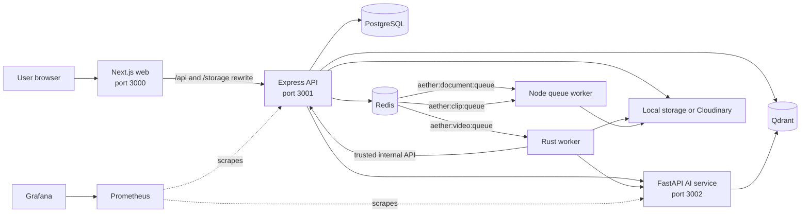
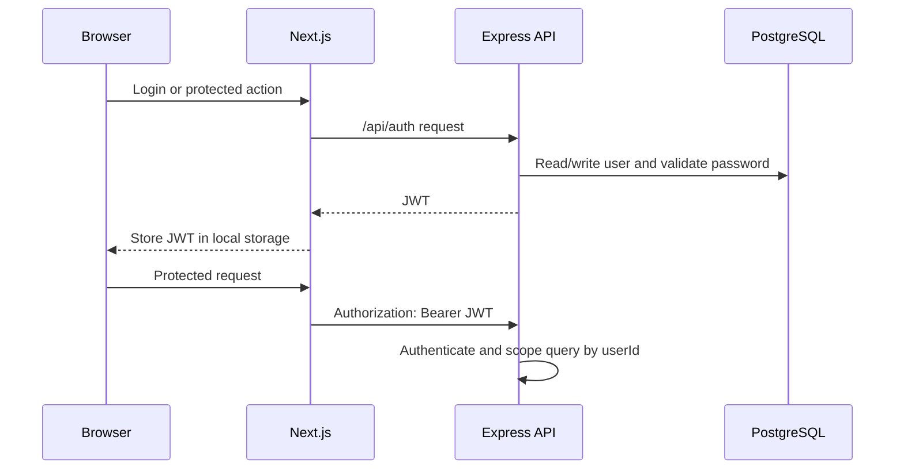
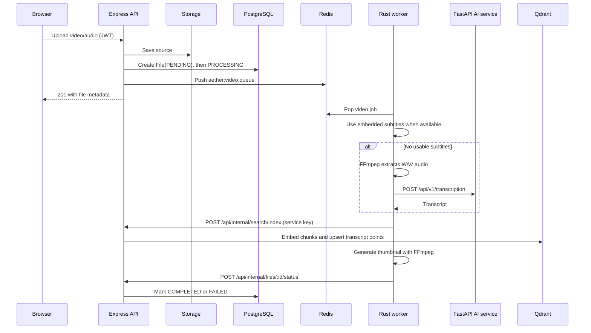

# Aether: Current System Architecture

This document describes the architecture implemented by the current source tree. It is the canonical map for the running services, queues, storage, and request flows. Where older documentation conflicts with the entry points listed below, follow the source files named in this document.

## 1. Purpose and boundaries

Aether is a multi-user knowledge workspace. A user can upload documents, audio, or video; the system extracts searchable content; and the user can search, chat, create clips, and run video-intelligence features over their own indexed files.

The system is a pnpm/Turborepo monorepo with four application processes:

| Process | Technology | Responsibility | Entrypoint |
| --- | --- | --- | --- |
| `web` | Next.js / React | Browser UI, authentication state, dashboard views | `apps/web` |
| `api` | Express / TypeScript | Public API, authorization, relational persistence, orchestration | `apps/api/src/server.ts` |
| `ai-service` | FastAPI / Python | Extraction, chunking, embeddings, RAG, LLM and transcription endpoints | `apps/ai-service/app/main.py` |
| `rust-worker` | Tokio / Rust | Long-running Redis video jobs, FFmpeg work, transcription handoff | `apps/rust-worker/src/main.rs` |

Redis and Qdrant are local infrastructure services. PostgreSQL is an external dependency supplied by `POSTGRES_URL`; it is not defined in the root Compose file.

## 2. System context



The web application is the only browser-facing UI. The API is the primary public backend boundary. The AI service and workers are service-to-service dependencies rather than public application backends.

## 3. Container and data ownership

### Web application

- Renders the landing, authentication, upload, search, chat, file, clip, and video dashboard pages.
- Uses an Axios client whose base URL is `NEXT_PUBLIC_API_URL` and attaches the JWT from browser local storage.
- Rewrites `/api/*` and `/storage/*` to the API origin, which lets a browser use same-origin paths when configured that way.
- Keeps UI-oriented state in Zustand stores; server-side authoritative state is never stored in the browser.

Key sources: `apps/web/src/lib/api.ts`, `apps/web/src/store/*`, and `apps/web/next.config.js`.

### Express API

The API owns the public REST contract and enforces user ownership with JWT authentication. Route groups are registered under `/api` in `apps/api/src/server.ts`:

| Route group | Responsibility |
| --- | --- |
| `/api/auth` | Registration, login, token issuance and identity |
| `/api/files`, `/api/files/upload`, `/storage` | File records, upload, retrieval and static local files |
| `/api/chat` | Chat sessions/messages, retrieval orchestration and streaming |
| `/api/search`, `/api/index` | Semantic search and direct indexing |
| `/api/clips` | Clip records and asynchronous generation requests |
| `/api/video`, `/api/video-features` | Video intelligence and video-specific UI data |
| `/api/users` | User information and statistics |
| `/api/internal` | Rust-worker-only status and transcript-indexing callbacks |

The API owns state transitions for `File` and `Clip` records and persists chats. It also requeues stale file records in `PENDING` or `PROCESSING` state during startup.

### PostgreSQL

Prisma models relational application state:

- `User` is the account root.
- `File` contains upload metadata, storage location, processing status, and the owning user.
- `Session` and `Message` persist chat history.
- `Clip` records user-owned excerpts of a source file.
- `Job` models a product-level job record, although current queue status is also kept in Redis hashes.

File and clip statuses are `PENDING`, `PROCESSING`, `COMPLETED`, or `FAILED`. The schema is in `apps/api/prisma/schema.prisma`.

### Redis

Redis is the asynchronous-work transport and short-lived job-status store. The API pushes JSON job payloads to lists and writes status to `aether:job:<job-id>` hashes.

| Queue | Producer | Intended consumer | Work |
| --- | --- | --- | --- |
| `aether:video:queue` | Express API | Rust worker | Video/audio transcription, indexing and thumbnails |
| `aether:document:queue` | Express API fallback | Node queue worker | Document indexing through the AI service |
| `aether:clip:queue` | Express API fallback | Node queue worker | FFmpeg clip cutting and thumbnail generation |

The Rust process reads only the video queue in its running `QueueWorker`. The Node worker (`pnpm --filter api worker` or `pnpm worker` from `apps/api`) polls the document and clip queues.

### Qdrant

Qdrant stores embedding vectors and source payloads. Collections are per user and named `user_<user-id-with-hyphens-replaced-by-underscores>`. A point includes the chunk text, `file_id`, `user_id`, optional file name, and metadata such as transcription timing. This isolation is applied by API and AI-service retrieval paths, not by a database-level Qdrant tenant feature.

### File storage

`StorageService` supports local storage and Cloudinary:

- Local files live under `apps/api/storage/uploads`, `apps/api/storage/clips`, and `apps/api/storage/thumbnails` by default and are served from `/storage/*`.
- With `STORAGE_TYPE=cloudinary`, the API uploads file data to Cloudinary and stores the Cloudinary public ID plus URL in the `File` record.
- Rust and Node processing workers require access to the original source path. A deployed topology therefore needs compatible storage access for all processes, rather than only API access.

## 4. Core processing flows

### 4.1 Authentication and authorized requests



The API checks file ownership before chat, search, clip, and video-intelligence operations. The Rust worker does not use a user JWT; it calls `/api/internal/*` with `x-service-key`, which the API validates against `SERVICE_API_KEY`.

### 4.2 Document upload and indexing

```mermaid
sequenceDiagram
  participant B as Browser
  participant A as Express API
  participant S as Storage
  participant P as PostgreSQL
  participant AI as FastAPI AI service
  participant R as Redis
  participant NW as Node queue worker
  participant Q as Qdrant

  B->>A: POST /api/files/upload (JWT, file)
  A->>S: Save original file
  A->>P: Create File(PENDING)
  A->>P: Set File(PROCESSING)
  A-->>B: 201 with file metadata
  A->>AI: POST /api/v1/documents/index (background)
  AI->>AI: Validate readable path, extract, chunk, embed
  AI->>Q: Create user collection if needed; upsert chunks
  A->>P: Set File(COMPLETED)
  Note over A,R: On direct indexing failure
  A->>R: Push aether:document:queue
  NW->>R: Poll job
  NW->>AI: Retry document indexing
  NW->>P: Mark COMPLETED or FAILED
```

Accepted document formats include PDF, DOCX, XLSX, text, Markdown, and CSV. The AI service restricts path-based indexing to configured storage roots before it reads a file. Its pipeline extracts text, chunks it with configured size/overlap, embeds chunks, and writes points to the user collection.

### 4.3 Video or audio upload and processing



The Rust worker treats subtitles as a higher-fidelity transcript and falls back to FFmpeg audio extraction plus the AI transcription endpoint. For media without an audio track, it can generate a thumbnail and complete without indexing a transcript. It removes temporary extracted audio after processing.

### 4.4 Search and RAG chat

```mermaid
sequenceDiagram
  participant B as Browser
  participant A as Express API
  participant P as PostgreSQL
  participant AI as FastAPI AI service
  participant Q as Qdrant
  participant L as Configured LLM provider

  B->>A: Search query or chat message (JWT)
  A->>P: Verify user/file ownership; create session/message for chat
  A->>L: Generate query embedding
  A->>Q: Search user_<userId>, optionally filter by file_id
  A->>AI: POST /api/v1/chat with retrieved context
  AI->>Q: Retrieve additional RAG context
  AI->>L: Generate answer from question and context
  AI-->>A: Answer and source chunks
  A->>P: Persist assistant message
  A-->>B: Answer, session id, sources (or SSE for streaming)
```

The API performs a first retrieval pass so it can return sources and construct context. The AI chat endpoint can retrieve again before it calls its configured LLM provider. If vector retrieval fails, the API degrades to context-free generation; if the AI-service call fails, it can use its direct AI client fallback.

### 4.5 Video intelligence and clips

Video intelligence endpoints first confirm that the requested `File` belongs to the user, then delegate to the AI service. The AI service retrieves transcript chunks from Qdrant and asks the LLM to derive moments, highlights, topics, and summaries.

Clip creation persists a `Clip` row, then tries a Rust worker HTTP endpoint first (`RUST_WORKER_URL`). If that call is unavailable, it puts a `ClipGenerate` job on `aether:clip:queue`; the Node queue worker cuts the media with FFmpeg, creates a thumbnail, and updates the existing clip row. The Rust source also contains a clip-worker implementation, but the primary Rust queue loop currently consumes the video queue only.

## 5. Deployment topology

`docker-compose.yml` starts the following on the `aether-network` bridge:

| Service | Published port | Dependencies / persistent data |
| --- | --- | --- |
| `web` | 3000 | Depends on API |
| `api` | 3001 | PostgreSQL URL, Redis, Qdrant, AI service, storage volumes |
| `ai-service` | 3002 | Qdrant, model-provider credentials, AI cache |
| `rust-worker` | none | Redis, API, AI service, worker-local video volume |
| `redis` | 6379 | Redis container |
| `qdrant` | 6333 HTTP, 6334 gRPC | `qdrant_data` volume |
| `prometheus` | 9090 | Prometheus configuration/data volume |
| `grafana` | 3004 | Grafana provisioning/data volume |

The root `start` script runs API, web, AI service, and Rust worker for local development. The API Node queue worker is a separate script and is not included in that root start command or the Compose API command.

## 6. Configuration and trust boundaries

| Boundary | Key configuration | Notes |
| --- | --- | --- |
| Browser to API | `NEXT_PUBLIC_API_URL`, `API_ORIGIN`, `CORS_ORIGIN` | Browser has only a user JWT, never service credentials. |
| API to PostgreSQL | `POSTGRES_URL`, optional direct URL | Prisma is the persistence client. |
| API/workers to Redis | `REDIS_HOST`, `REDIS_PORT`, `REDIS_URL` | Used for queue transport and job state. |
| API/AI to Qdrant | `QDRANT_HOST`, `QDRANT_PORT`, `QDRANT_API_KEY` | Vector storage for RAG. |
| API/Rust to AI service | `AI_SERVICE_URL` | Internal HTTP endpoint surface. |
| Rust to internal API | `SERVICE_API_KEY` | Required; absent key disables `/api/internal` calls. |
| API and AI service to model providers | `NVIDIA_API_KEY`, model settings | Embeddings and LLM responses; the AI service also hosts transcription. |
| Storage | `STORAGE_TYPE`, `CLOUDINARY_*`, upload/clip paths | Every processing worker must access source files. |

Security controls present in the source include JWT authentication, user-scoped database lookups, input validation on public routes, MIME-type and size limits for uploads, allowed-root checks in the AI service, Express Helmet/CORS middleware, and constant-time service-key checks for internal endpoints.

## 7. Operational behaviour and current alignment points

These are implementation facts to account for when deploying; they are not speculative redesigns.

1. Start the Node queue worker if document fallback or Redis-queued clips are required. Compose and the root `start` script do not currently launch it.
2. Ensure storage is shared or otherwise reachable by API, AI service, Rust worker, and Node queue worker. A database record alone does not make a local upload available inside another container.
3. Configure the same non-empty `SERVICE_API_KEY` in API and Rust worker. Otherwise, a processed transcript cannot be indexed through the internal API and file status cannot be updated by the Rust worker.
4. Treat `File.status` as the user-facing processing state and Redis `aether:job:*` hashes as transient queue progress. A `Job` Prisma model exists but is not the primary queue implementation in the currently wired upload paths.
5. The health endpoint at `/api/health/detailed` checks PostgreSQL, Redis connectivity, FastAPI health, and Qdrant. Use it to validate the central dependency chain.

## 8. Source-of-truth map

| Concern | Primary source |
| --- | --- |
| API composition and health | `apps/api/src/server.ts` |
| Public API routes | `apps/api/src/routes/*.ts`, `apps/api/src/modules/auth` |
| Relational data model | `apps/api/prisma/schema.prisma` |
| Queues and Node worker | `apps/api/src/services/queue.service.ts`, `apps/api/src/workers/queue.worker.ts` |
| AI service routes and pipeline | `apps/ai-service/app/main.py`, `apps/ai-service/app/api/routes`, `apps/ai-service/app/services` |
| Video queue consumption | `apps/rust-worker/src/workers/queue_worker.rs`, `apps/rust-worker/src/workers/video_worker.rs` |
| Browser-to-API routing | `apps/web/src/lib/api.ts`, `apps/web/next.config.js` |
| Deployable service topology | `docker-compose.yml` |
